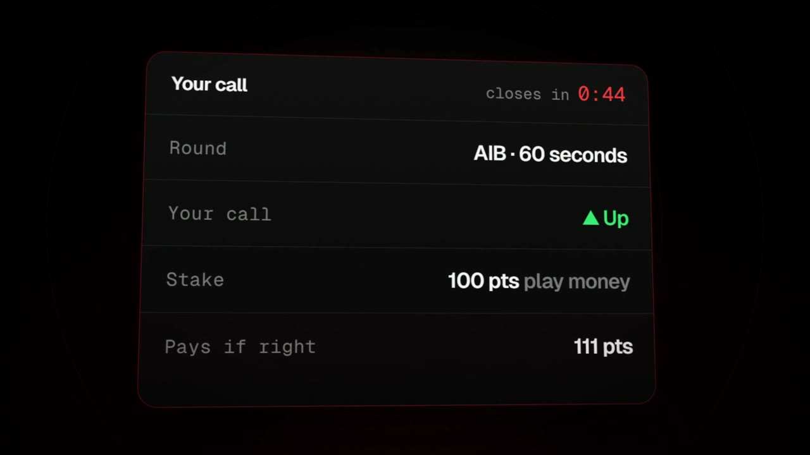
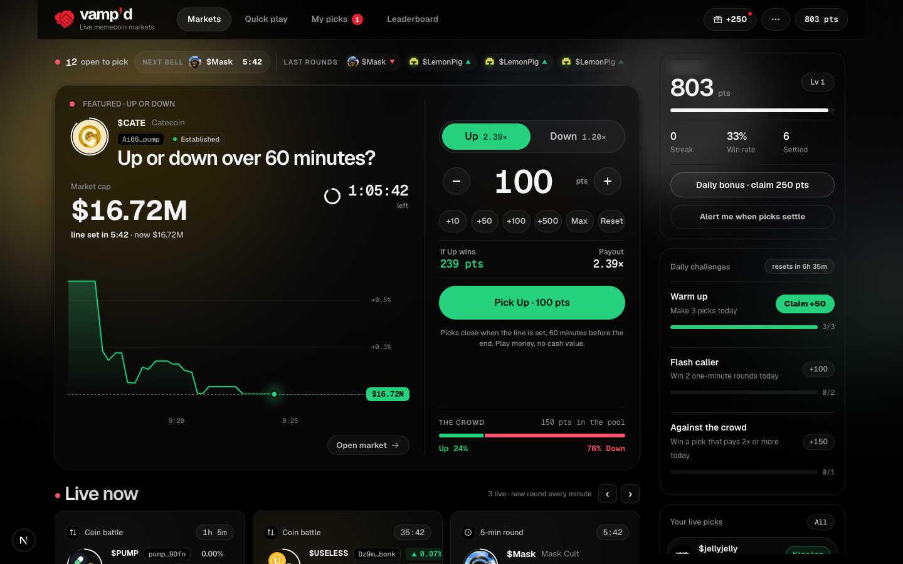
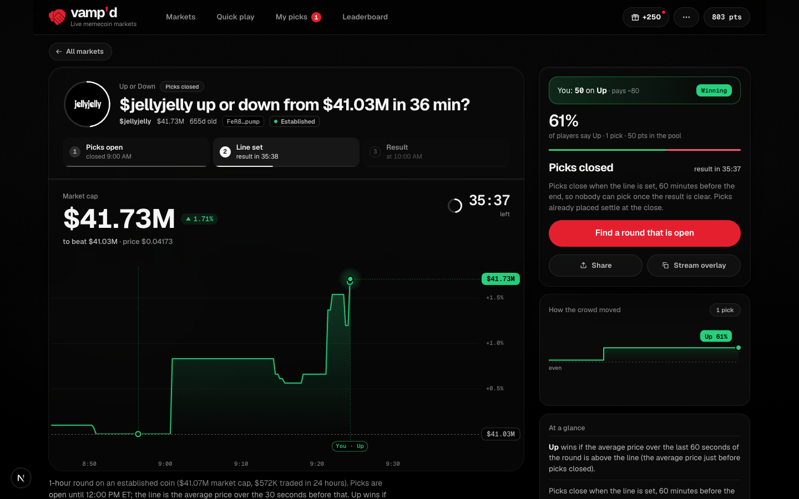
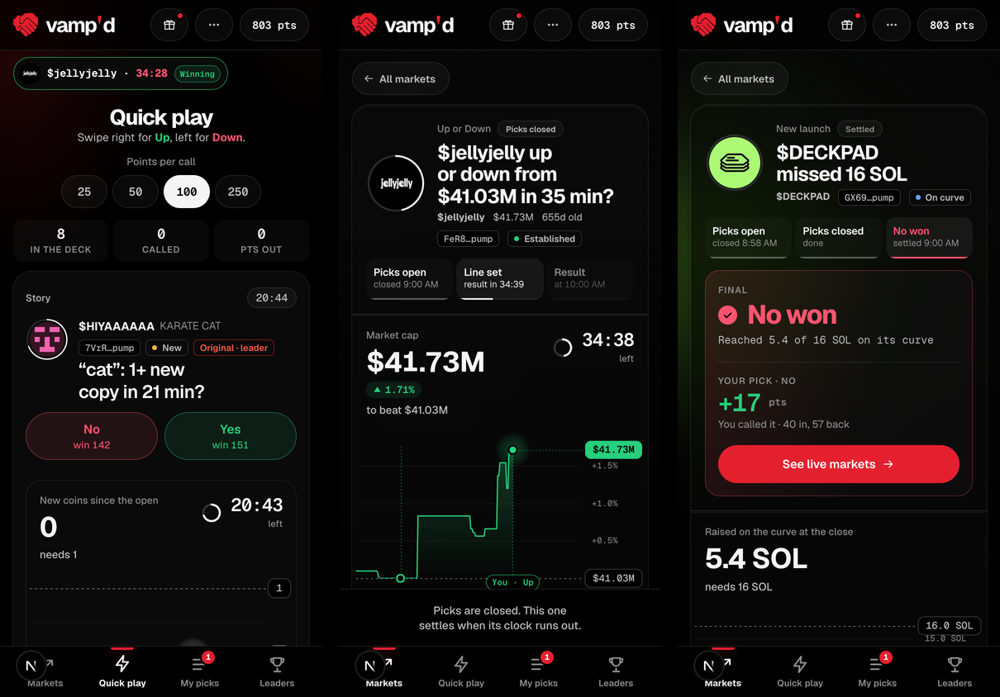
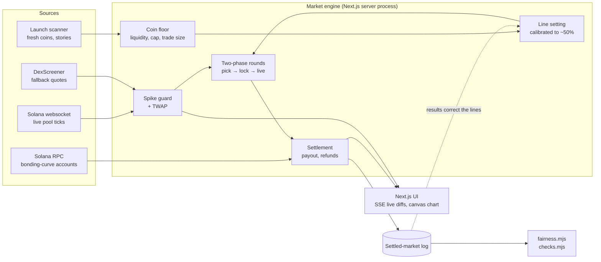

# vamp'd

**A live prediction market for memes and culture: For Trading the Culture.**
Up-or-down rounds on real Solana memecoins, settled in minutes, with play money.

**Live:** [theniche.app/vampd](https://theniche.app/vampd) · **Launch film (30 s):** [watch](media/launch-film.mp4) · Full-quality 1080p in [Releases](../../releases)

I designed and built it end to end: market design, the settlement engine, on-chain price reads, the Next.js app, the motion work and the launch film. It went from first commit to a public launch in two weeks (Nov 2–16, 2026): 184 commits, about 11k lines of TypeScript.

| Home | Market page |
|---|---|
|  |  |

---

## What it does

Every minute, the engine finds the memecoins with real trading on them and opens markets on them:

- **Flash / 5-min / 15-min / 1-hour rounds**: will the price be up or down from the line?
- **Battles**: which of two coins gains more?
- **Event markets**: will a fresh launch reach N SOL on its bonding curve? Will it graduate? Will a story spawn N copies?

Pools are parimutuel: the winning side splits the pool, minus a 2% fee. Each side gets a house seed, split by the measured chance, so odds exist before the first pick.

## Architecture

It runs as one Next.js app. The engine lives inside the server process, on a 2.5 s price loop and a 20 s market loop. Live price changes reach the browser as small server-sent diffs. The app is self-hosted on a home server, published through a Tailscale Funnel, and served under `theniche.app/vampd` by a Vercel rewrite. `lib/paths.ts` exists because of that rewrite.

---

## Engineering stories

### 1. The market was 79% Up, and the cause was wash trading, not the lines
After launch, 1-minute rounds closed **Up 79% of the time** (n = 1,211), and 5-minute rounds 71%. The lines weren't wrong: each was the live price at the open. The problem was the coins. Most coins that passed the listing floor were being walked up by volume bots, which place thousands of $1–2 trades until the pool is pulled. One coin closed Up in 96% of 72 rounds. Of 32,530 coin-moments that passed the old floor, 35% collapsed within the hour.

**Fix:** a listing floor on **average trade size**. Over 12 days of history, coins averaging under $20 per trade closed Up 76% of the time, and coins above it 51%. I replayed the scanner's history through the new floor before shipping (`floor_replay`). On the last 3 days, the old floor gave Up rates of 72% / 72% / 56% at 1, 5 and 15 minutes. The new floor gave 53% / 53% / 49%. After launch, coins whose recent rounds still all close one way are dropped automatically.

### 2. 6 of 49 launch markets settled the wrong way, so settlement moved to the chain
I checked launch markets against the scanner's trade log: 6 of 49 had settled wrong. In some, a target was touched between two reads 10–20 s apart. Others got a Yes from a lagging price source. Two sources also disagreed by 20% or more on fast coins (35 vs 49 SOL on the same coin, seconds apart).

**Fix:** open and settle curve markets from the coin's **bonding-curve account on Solana**. The address is derived locally from the mint, with no lookup service; the derivation was checked against the scanner on 60 of 60 coins. Every account change is pushed over a websocket, with a 5-second batched read as a backstop. See [`src/engine/curve.ts`](src/engine/curve.ts). It includes the ed25519 on-curve check that PDA derivation needs, written with BigInt so the engine has no Solana SDK dependency.

### 3. Picks, then lock: two-phase rounds
Flash rounds used to take picks until 10 s before the end, when the price was already 50 s into the round. Event markets had a different problem: 66% of launch markets that ended Yes did so in the first 5% of the window, with a median of 18 s.

**Fix:** I studied how Polymarket, Kalshi, PancakeSwap Prediction and parimutuel racing handle this, then adopted the same principles:
- Price rounds run in **two phases**: picks are open until the lock, the line is fixed at the lock, and no picks are taken after it.
- The line and the close are both **time-weighted averages** (5 s / 10 s for 1-minute rounds, up to 60 s for 1-hour rounds), so no single trade can set either.
- A live tick that jumps more than 3% is **held until the next tick confirms it**.
- Event targets sit at least a minute of the coin's current pace away.
- An exact tie or a dead price feed is refunded, and the market's own text says so.

See [`src/engine/rounds.ts`](src/engine/rounds.ts) and [`src/engine/decided.ts`](src/engine/decided.ts).

### 4. A fairness check that fails the build
Each kind of market has to be a real bet: Yes should win **35–65%** of the time. [`scripts/fairness.mjs`](scripts/fairness.mjs) reads the settled-market log and reports per kind:
- the Yes rate with a Wilson 95% interval, before and after the rule change
- the seed estimate against the actual result
- refunds, with the ones caused by server downtime split out
- event markets decided in the first 5% of their window
- coins whose rounds close one way

It exits with code 1 when a kind's whole interval is outside the band. Line setting is closed-loop: the calibration table's chance is corrected by actual results in log-odds, from 10 results per kind and 15 per bucket ([`fair.ts`](src/engine/fair.ts) `correct`).

| Market type | Yes rate before | Yes rate after | 95% interval after |
|---|---|---|---|
| launch | 69% (n=524) | 43% (n=321) | 38–49% |
| 5-min round | 71% (n=131) | 58% (n=59) | 45–69% |
| 15-min round | 57% (n=138) | 46% (n=65) | 35–58% |
| 1-hour, established coins (new) | n/a | 46% (n=139) | 38–54% |
| story: leader holds #1 | 71%, plus 12 of 42 refunded | 45%, 1 refunded | 33–57% |

**What's still weak:**
- Flash rounds improved from 79% to **69% Up** (n=142), which is still above the band. Four coins went 33-for-33 Up before the one-way guard caught them. The guard has been tightened, but the result isn't re-measured yet.
- Three market types couldn't be made fair (one ran 76–99% Yes in every bucket of history), so I removed them.
- 470 one-hour rounds were refunded because the host machine slept through the lock or the close. That's the refund rule working correctly, but it is an infrastructure problem, and hosting has since moved.

### 5. Payout math with no free side
- A winner never gets back less than their stake. Before this fix, a 10,000-point pick into a pool holding little more than the seed could win and still lose points to the fee.
- The house seed is split by the measured chance, so a 40% outcome opens at about 2.4x, not 2x.
- A check runs 20,000 random pools and asserts that a first pick at the seed's own chance returns **under 1.00 on average**. Run `node scripts/checks.mjs`: 24 checks, no server needed.

### 6. A chart that's always moving, at 60 fps
The live chart ([`src/ui/LiveChart.tsx`](src/ui/LiveChart.tsx)) is a single canvas render loop:
- The time axis scrolls with the clock every frame.
- The head rides just under one sample behind the feed, so it never waits and then jumps.
- New data never redraws the line. Each drawn point springs to its real value through a **critically damped spring, integrated exactly**, so it behaves the same at any frame length and never overshoots.
- The y-scale changes rarely, and when it does it moves as a spring.
- The loop pauses off-screen and in hidden tabs, and respects reduced motion.

I measured it with a frame harness on the real feed (600 frames, headless Chrome):

| | Before | After |
|---|---|---|
| Worst frame-to-frame jerk of the head | 1.49 px | **0.21 px** (7x smoother) |
| Frames where the head stood still | 6 | **0** |
| JS time per frame (p50) | 0.6 ms | **0.2 ms** |
| Frame rate | 60 fps | 60 fps (56.5 on a 4x-throttled phone profile) |

Side-by-side stress test (old chart on top, new on the bottom): [media/chart-stress-old-vs-new.mp4](media/chart-stress-old-vs-new.mp4). Write-up: [docs/live-chart-motion.md](docs/live-chart-motion.md).

### 7. Load glitch: CLS 0.0286 → 0
On desktop, the market page shifted on load: three side panels arrived after first paint and pushed the layout. Route prefetches behind the rewrite also returned 404s. Both are fixed. I measured with a layout-shift probe at 1440 px and 390 px on home, market, join and first visit: market-page CLS went from **0.0286 to 0**, and the prefetch 404s went from 2–4 per page to none.

The site-wide redesign covered all 12 page types. For each page I started from a measured teardown of the best reference (Polymarket, Kalshi, Hyperliquid), then captured it at 1440 px and 390 px over 2–4 rounds. A scripted browser flow covered the key path: open market → pick → toast → My picks.

---

## Research rigor

Before vamp'd I built a Solana memecoin research stack: a launch scanner, a trade tape, and a nightly ledger that grades candidate trading rules. The ledger tested **540,000+ rules**. Most of that work was learning how a backtest lies, and building gates that catch it:

- **Purged, embargoed walk-forward** (López de Prado). Rules are chosen on the oldest half and judged on the newest. Rows that share a launch script with the selection window are purged, with a 60 s embargo.
- **Multiple-testing control.** Deflated Sharpe ≥ 0.95, White's reality check with a cluster bootstrap, and cluster-robust t-stats (Cameron & Miller). Launch scripts from the same operator are clustered, so one serial launcher can't pass as 600 independent trades. In one case, 15,134 triggers turned out to be 8,333 clusters.
- **Outlier and exit honesty.** Every mean is printed next to the median, the mean without the top 3 trades, and the cluster mean. Exits that the data can't actually price are dropped and counted, not booked at the last known price. At a 60 s hold, that was 27% of triggers.
- **Feed-lag realism.** Fills are delayed by each trigger's own measured receive lag, not counted from block time.

These gates **killed every lead**:
- A rule that looked like +21.5% per trade forward lost **4.6% per trade on two months of full history** (n = 8,540, both halves negative). Its recent "edge" came from a single bundled-launch script.
- A crowd-state signal at +18.7% per trade turned out to be **look-ahead bias**. Its features were built from trades received before the fill's wall-clock second, which on a lagging feed included trades from after the fill. With that fixed, it dropped to +3.2% (t = 1.1). On history, deliberately recreating the bug "made" +12.5% per trade over 8,873 trades, 55 of 62 days positive.
- After the hygiene pass, the ledger went from 63 "holding" rules to 16, and then to **0 rules near go-live**. A reality check on the 197 rules with forward data gave **p = 0.93**.

I'd rather report that than ship a flattering number. Method write-up: [docs/research-hygiene.md](docs/research-hygiene.md).

---

## How I build

I direct AI coding agents (Claude Code), usually several in parallel, and hold them to evidence:
- type checks and unit-style checks (`checks.mjs`)
- data checks that can fail the build (`fairness.mjs`)
- scripted browser flows and captures at desktop and phone widths
- frame-level checks for motion: per-frame harness metrics, frame sheets of every animation
- before/after measurements for every performance claim

I set the bar, read the diffs, and reject anything I can't verify. The numbers in this README come from those checks.

## Repository map

| Path | What it is |
|---|---|
| [`src/engine/rounds.ts`](src/engine/rounds.ts) | Engine excerpts: round phases, coin floor, opening odds, settlement, spike guard, lock/settle |
| [`src/engine/fair.ts`](src/engine/fair.ts) | TWAP, payout, results correction, Wilson interval |
| [`src/engine/decided.ts`](src/engine/decided.ts) | When picks close: lock, half-window, decided-early guards |
| [`src/engine/calibration.ts`](src/engine/calibration.ts) | Line setting, aimed at 50% inside a 35–65% band |
| [`src/engine/curve.ts`](src/engine/curve.ts) | Bonding-curve reads from Solana, PDA derivation without an SDK |
| [`src/engine/resolved.ts`](src/engine/resolved.ts) | Settled-market log, rules versions, result stats |
| [`src/api/guard.ts`](src/api/guard.ts) | Rate limiter and body guards |
| [`src/lib/paths.ts`](src/lib/paths.ts), [`question.ts`](src/lib/question.ts) | Base path / origin; market wording |
| [`src/ui/LiveChart.tsx`](src/ui/LiveChart.tsx) | The live chart |
| [`scripts/`](scripts) | `checks.mjs` (runs here) and `fairness.mjs` (needs the private log) |
| [`docs/`](docs) | [Market fairness](docs/market-fairness.md) · [Live chart motion](docs/live-chart-motion.md) · [Research hygiene](docs/research-hygiene.md) |

[SOURCE.md](SOURCE.md) lists what's included and what was left out.

---

**Contact:** [qatanaah@gmail.com](mailto:qatanaah@gmail.com) · [LinkedIn](https://www.linkedin.com/in/qatanaa/)

© 2026. All rights reserved. This repository is a portfolio showcase, not open-source software. See [LICENSE](LICENSE). vamp'd uses play money only; points have no cash value.
